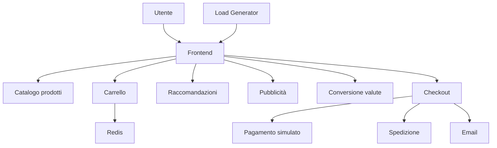

# Architettura — Online Boutique

## Diagramma dei componenti

## Come funziona

L'utente accede al negozio tramite il frontend, che comunica con gli altri microservizi.

Il catalogo mostra i prodotti, il carrello utilizza Redis per conservare i dati e il checkout coordina pagamento, spedizione e conferma dell'ordine.

Le comunicazioni interne avvengono principalmente tramite gRPC, mentre il sito web utilizza HTTP.

Il Load Generator simula il traffico degli utenti.

Il progetto è stato eseguito su Kubernetes, con due ambienti logici separati: DEV e PROD

## Architettura Kubernetes e componenti di piattaforma

L'applicazione è distribuita su un cluster Kubernetes locale Kind denominato `prova`, con due namespace separati: `dev` e `prod`.

Ogni ambiente contiene i microservizi di Online Boutique. I Deployment gestiscono i Pod applicativi, mentre i Service permettono la comunicazione interna. Il frontend espone HTTP e comunica con i servizi interni principalmente tramite gRPC. Redis viene utilizzato dal servizio carrello come archivio temporaneo.

**Accesso esterno:** l'applicazione è stata verificata tramite `kubectl port-forward`. Nel namespace DEV è stata creata una risorsa Ingress, ma non è stato installato un Ingress Controller; pertanto l'instradamento attraverso Ingress non è stato dimostrato.

**Configurazione e sicurezza:** nel namespace DEV il frontend riceve configurazioni tramite `frontend-config` (ConfigMap) e `frontend-secret` (Secret). Sono stati inoltre configurati ServiceAccount, Role e RoleBinding per dimostrare il principio del minimo privilegio.

**CI/CD:** GitHub Actions esegue automaticamente i test Go e la build Docker del frontend. Il deployment in DEV avviene manualmente tramite `deploy-dev.bat`, che costruisce l'immagine, la carica nel cluster Kind e aggiorna il Deployment.

**Osservabilità:** il frontend produce log strutturati JSON e utilizza probe HTTP di readiness e liveness sull'endpoint `/_healthz`. Lo script `metrica.ps1` calcola il tempo medio di risposta delle richieste HTTP analizzando i log. Non è stato implementato un sistema di monitoraggio continuo con Grafana e Prometheus.

**Krateo:** è stata proposta un'integrazione futura come livello di catalogo self-service, standardizzazione e governance. La valutazione tecnica e il relativo diagramma concettuale sono documentati in `readmechallenge.md`.

Il diagramma dei componenti rappresenta i principali flussi applicativi in forma semplificata e non tutte le singole chiamate tra microservizi.