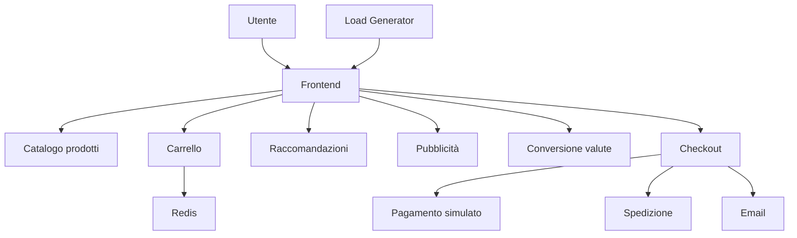

# Architettura — Online Boutique

## Diagramma dei componenti

## Come funziona

L'utente accede al negozio tramite il frontend, che comunica con gli altri microservizi.

Il catalogo mostra i prodotti, il carrello utilizza Redis per conservare i dati e il checkout coordina pagamento, spedizione e conferma dell'ordine.

Le comunicazioni interne avvengono principalmente tramite gRPC, mentre il sito web utilizza HTTP.

Il Load Generator simula il traffico degli utenti.

Il progetto verrà eseguito su Kubernetes, con due ambienti logici separati: DEV e PROD.